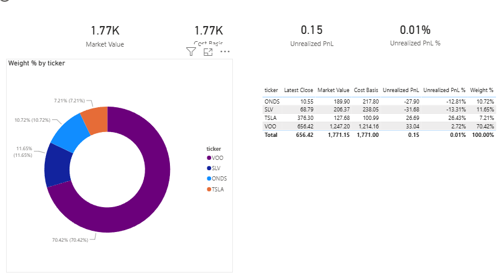
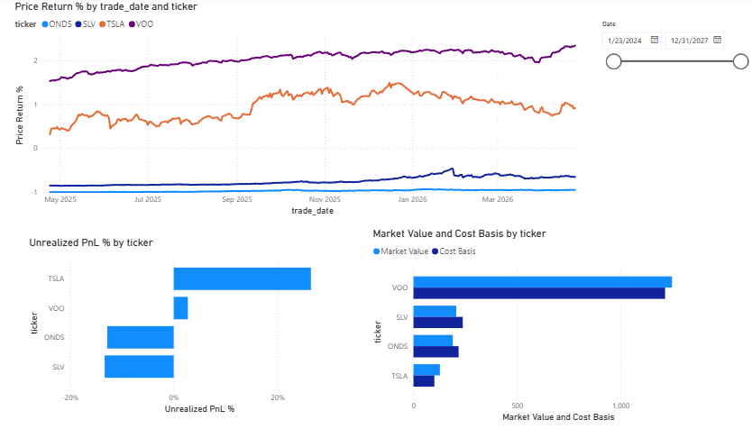
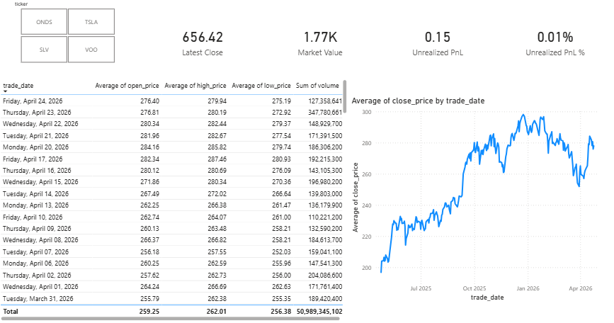

# Stock Portfolio Tracker

A serverless AWS data pipeline that fetches daily US stock prices, stores them as date-partitioned Parquet in S3, and serves them to a Power BI dashboard through Athena. It refreshes nightly with no servers to manage, and costs close to $0 a month to run.




## Architecture

```
 EventBridge (cron, weekdays after US close)
        │
        ▼
 ┌──────────────┐   reads tickers   ┌──────────────────────────┐
 │  AWS Lambda  │ ◀──────────────── │ S3: holdings/holdings.csv │
 │  Python 3.12 │                   └──────────────────────────┘
 │              │ ──── yfinance ───▶  Yahoo Finance (OHLCV)
 └──────┬───────┘
        │ writes Parquet
        ▼
 ┌────────────────────────────────────────┐
 │ S3: prices/y=YYYY/m=MM/d=DD/            │
 │     prices.parquet                      │
 └──────┬─────────────────────────────────┘
        │ external table (Glue Data Catalog)
        ▼
 ┌──────────────┐   ODBC    ┌───────────────────────────────┐
 │    Athena    │ ────────▶ │ Power BI: star schema + DAX,  │
 │   (SQL)      │           │ nightly scheduled refresh     │
 └──────────────┘           └───────────────────────────────┘
```

### How it works

1. **Schedule.** An EventBridge rule (`cron(30 21 ? * MON-FRI *)`, 4:30 PM ET) invokes the Lambda after the US market closes.
2. **Read holdings.** The Lambda reads `holdings/holdings.csv` (ticker, quantity, average cost) from S3. You add or remove a position by editing this file, with no code change.
3. **Fetch prices.** It downloads OHLCV data for every ticker in one batched `yfinance` call.
   - **First run:** if no price data exists yet, it backfills 1 year of history.
   - **Daily run:** after that, it fetches only the last 2 days.
4. **Store.** It writes the rows as a single Parquet file to a Hive-style date partition (`prices/y=2026/m=04/d=21/`). If today's partition already exists, it skips the write. That makes re-runs idempotent and protects the backfill from being overwritten.
5. **Query.** Athena exposes the Parquet files as an external `prices` table. Because the data is partitioned and columnar, each query scans only a few KB to MB.
6. **Visualise.** Power BI connects to Athena over ODBC, models the data as a star schema, and refreshes nightly.

## Power BI report

The report is in [`powerbi/portfolio.pbix`](powerbi/portfolio.pbix).

**Star schema**

| Table | Role | Key columns |
|---|---|---|
| `prices` | Fact: one row per ticker per trading day | `ticker`, `trade_date`, `open_price`, `high_price`, `low_price`, `close_price`, `volume` |
| `dim_holdings` | Dimension: current positions | `ticker`, `qty`, `avg_cost` |
| `dim_date` | Dimension: calendar for time intelligence | `Date` |

**DAX measures:** Market Value, Cost Basis, Unrealized P&L, Unrealized P&L %, Weight %, Latest Close, Price Return %

**Pages**

- **Overview:** KPI cards for Market Value, Cost Basis, Unrealized P&L and P&L %, a portfolio-weight donut chart, and a per-holding summary table.
- **Performance:** price return % over time per ticker, P&L % by ticker, market value vs cost basis, and a date slicer.
- **Holdings:** a ticker drill-down with the latest close, position KPIs, a daily OHLCV table and a close-price trend.

**Performance**



**Holdings**



## Repository layout

```
lambda/
  lambda_function.py   Handler: read holdings → fetch prices → write Parquet
  holdings.py          Reads holdings.csv from S3
  prices.py            yfinance OHLCV fetcher (handles single and multi-ticker responses)
  storage.py           First-run detection + partitioned Parquet writer
sql/
  create_prices_table.sql   Athena DDL for the partitioned external table
scripts/
  build_layer.sh       Builds the Lambda layer (yfinance, pandas, pyarrow) for Linux x86_64
data/
  holdings.csv         Holdings uploaded to s3://<bucket>/holdings/holdings.csv
powerbi/
  portfolio.pbix       Power BI report
tests/                 pytest unit tests (S3 and yfinance are mocked)
docs/                  Design spec and implementation plan
```

## Running the tests

```bash
pip install -r requirements.txt
pytest
```

The tests mock S3 and yfinance, so they need no AWS credentials or network access.

## Deploying

1. **S3.** Create a bucket and upload `data/holdings.csv` to `holdings/holdings.csv`.
2. **Lambda layer.** Run `scripts/build_layer.sh` and publish `lambda-layer.zip` as a layer (Python 3.12, x86_64).
3. **Lambda function.**
   - Runtime: Python 3.12, 512 MB memory, 5-minute timeout.
   - Code: zip the files in `lambda/` and attach the layer.
   - Environment variables:
     - `S3_BUCKET`: the bucket name.
     - `HOLDINGS_KEY`: `holdings/holdings.csv`.
   - IAM: the execution role needs `s3:GetObject`, `s3:PutObject` and `s3:ListBucket` on the bucket. No API keys are needed.
4. **EventBridge.** Create a rule with schedule `cron(30 21 ? * MON-FRI *)` that targets the function.
5. **Athena.** Run `sql/create_prices_table.sql`, with `LOCATION` pointing at your bucket. Run `MSCK REPAIR TABLE prices` to register new partitions.
6. **Power BI.** Install the Amazon Athena ODBC driver, create a DSN, open `powerbi/portfolio.pbix`, point it at your DSN, then publish and schedule a nightly refresh.

## Cost

At this scale (a handful of tickers, a few MB of Parquet), every service stays within the free tier or rounds to cents:

- **Lambda:** about 22 short invocations a month.
- **S3:** a few MB of storage.
- **Athena:** $5 per TB scanned, so queries over partitioned Parquet are effectively free.

## Design decisions

- **Serverless over a VM.** The job runs for seconds once a day, so a pay-per-invocation function fits better than an always-on server.
- **Parquet with Hive-style partitions.** The columnar format and partition pruning keep Athena scans, and so costs, minimal. New partitions are picked up with `MSCK REPAIR TABLE`.
- **Holdings as config in S3.** Changing positions doesn't need a redeploy.
- **Idempotent writes.** The handler checks whether today's partition exists before writing, so it's safe to retry. EventBridge retries failed invocations automatically.
